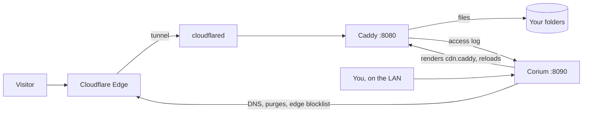

# Corium

Corium is a self-hosted control plane for a [Caddy](https://caddyserver.com) file server running behind a [Cloudflare Tunnel](https://github.com/cloudflare/cloudflared). It generates and validates your Caddy configuration, ingests domain access logs into SQLite, auto-bans scanners (with optional Cloudflare Edge sync), and provides a clean browser UI for managing files, accounts, and alerts.

[](LICENSE)   [](https://discord.gg/jRn5kbv2HX)


[Try a Demo](#try-a-demo) · [What it does](#what-it-does) · [Install](#install) · [How it works](#how-it-works) · [Configuration](#configuration) · [Platform support](#platform-support) · [Development](#development) · [Security](SECURITY.md) · [Discord](https://discord.gg/jRn5kbv2HX)

> Corium was called **Strata** until v0.5.0. File names, `STRATA_*` variables, and scheduled task names on disk still use `Strata` so existing installs upgrade in place. See [docs/RENAMING.md](docs/RENAMING.md) for the full list.

---

Corium runs on the same machine as Caddy and `cloudflared`. Dashboard changes are written to `generated/cdn.caddy` and checked with `caddy validate` before Caddy is ever reloaded, preventing broken configs from taking your server offline. With a Cloudflare API token, Corium also manages DNS records, cache purges, and the edge blocklist –  This token is optional, and strictly required for edge sync and other cloudflare(d) features.
The backend is written plain Python (no web framework), with data stored in a simple SQLite base, and a simple vanilla JavaScript dashboard with no build step or react / electron shenanegans.

Our development and production use happen on Windows. While Linux installs pass the test suite, we have no real data from a live production server yet; see [Platform support](#platform-support).
(How AI was used while building Corium: [AI Usage](docs/md/ai_usage.md))

## Want a Demo?

Corium includes a lightweight demo script; This script starts the full dashboard locally without Caddy, `cloudflared`, or a Cloudflare account, and generates about a week of synthetic traffic and (empty) sample files on startup:

```bash
git clone [https://github.com/Sanedish/corium.git](https://github.com/Sanedish/corium.git)
cd corium
pip install -r requirements.txt
python tests/demo.py
```

Once installed, open [http://127.0.0.1:8290](http://127.0.0.1:8290) on the same machine, or expose it on your network if needed. You're signed in as `alex`, everything runs in a temporary directory using documentation-reserved IP ranges. Simply stop the demo-server - `Ctrl+C` - to close the interface and remove it's demo data.
___
## What does Corium do?

### Serving files through Caddy:

A *drive* maps a local folder or a proxied service to a hostname and an optional URL prefix. Rules can be attached to an entire drive or a specific path, these rules include; IP allow/block lists, password protection, signed URLs, cache headers, gallery views, download prompts, and redirects. 

Your main Caddyfile simply imports the generated configuration (added automatically by the installer):

```caddyfile
import C:/Corium/generated/cdn.caddy
```

> (Previous versions of the generated config are saved automatically and can be restored from the dashboard.)

To save you bandwidth, Corium will detect compressible files that shrink enough to matter and write a Brotli copy alongside the original for Caddy to serve it directly to supporting browsers.

### Error pages, galleries, and audio player:

All three are plain HTML templates you can edit directly in the dashboard without touching application code, or fully replace with custom pages or host addresses. 

| Feature | How to enable | Template location |
| :--- | :--- | :--- |
| **Error pages** | `Site › Serving › Site › Error pages` | Copied from `static/errors/` to your preferred drive for reliability |
| **Gallery** | Add an access rule with the **Gallery view** action (e.g. `/photos/*`) | `gallery/gallery.html` – include `/*` to list subfolders too |
| **Audio player** | Add an access rule with the **Audio player** action (e.g. `/music/*`) | `player/player.html` – include `/*` to list subfolders too |

#### Error pages:

| 404 – Not Found | 403 – Access Denied | 502 – Bad Gateway |
| :---: | :---: | :---: |
|  |  |  |

In `Site › Serving › Site`, click **Edit** next to a status code. On first use, Corium copies the default pages from `static/errors/` into the drive's assets folder (`/_errors` by default) without overwriting existing files. **Preview** opens the page in a new tab.

Templates are included for `404` (missing or hidden files), `403` (blocked or trashed files), `500`, `502`, `503`, `504`, and drives in maintenance. Each page is a folder containing an `index.html` and an `info.md`:

```text
/_errors/
  _shared/site.md        defaults for every page: org name, mascot, background images
  _shared/page.js        renders a page from its info.md; style.css, img/ (WebP)
  not-found/info.md      code, title, which node is down, background, and "## What happened?" sections
  maintenance/demo.md    an example: open maintenance/index.html?demo
  ...
```

Edit `info.md` to customize a page: front matter holds the metadata (status code, title, background image), and each `## ` heading starts a section. If a specific reason is set in Corium (on a rule, when trashing a file, or during drive maintenance), it will replace the matching section automatically. These pages all support light and dark mode, will display the Cloudflare Ray ID, auto-reload when a `5xx` service recovers, and aren't cached. Unconfigured status codes will fall back to plain Caddy text.

For security reasons, error pages are served as static files rather than Caddy templates. **Running templates off a storage drive would expose Caddy's file and environment functions to anyone with write access to that folder!** Therefore, the reason, Ray ID, and version are passed via the `Server-Timing` response header, which browsers expose to JavaScript over HTTPS (skipped when running plain LAN HTTP).
___
#### Gallery and audio player:

| Gallery | Audio Player |
| :---: | :---: |
|  |  |

**A Gallery will...**
- Display directory contents as a responsive thumbnail grid with filtering, sorting (name, date, size), three tile sizes, and a full-screen lightbox. This gallery is currently quite rough, and will improve in the future.
- Requess thumbnails via `?w=`; when Media processing is enabled, Corium negotiates AVIF or WebP based on browser support.
- Retry thumbnails that are still encoding rather than serving the full-size original by mistake.
- Cache thumbnails at the Cloudflare edge while keeping directory listings uncached.

**An Audio player will...**
- Open a full-page web player with cover art, track title, artist, and a real-time spectrum visualizer.
- Detect cover art in the same folder (`cover.jpg`, `folder.jpg`, etc.) or falls back to a random image from a configured placeholder folder.
- Serve the raw audio stream automatically to mobile devices, `<audio>` tags, link preview crawlers, and requests with `?dl=1` or `?raw=1` to save resources. **This option will be a toggle (Settings > Serving) in future releases!**

**How to Customize the gallery and player:**
As both pages run as Caddy templates (safe in this case), edits take effect on the next request. Styling is controlled via CSS variables at the top of each file (`--bg` and `--accent` in the gallery; `--ink`, `--red`, and `--mono` in the player).
___
### Link previews:


When a link is shared in Discord, Slack, Telegram, X, or WhatsApp, Corium responds to crawler requests with a sleek preview card:
- **Audio:** Cover art and basic waveform
- **Code & text:** Repository-style preview card
- **Archives:** Terminal-styled directory listing
- **PDFs:** Document cover preview
- **Gallery folders:** Multi-image grid
- **Executables & scripts:** Caution card with the file's SHA-256 hash - These have been used for shady purposes before, just remove the warning if you don't like it.
- **Other files:** File type, size, and modification date (images, videos, and HTML pages keep their native embeds)

Hidden, password-protected, as well as held files, will never generate a preview! You can customize a file's title, description, accent color, card style, or preview image – or disable embeds entirely – from the **Embed** tab in the Files inspector.
> Note: Preview crawlers require `Zone › Cache Rules › Edit` on your Cloudflare API token (so crawler requests reach Corium instead of hitting Cloudflare's edge cache).
___
### Traffic:

| Live Request Log | Visitor Analytics |
| :---: | :---: |
|  |  |

Corium tails Caddy's access log into SQLite to power a live, filterable request log with saved views, visitor breakdowns (by country, ASN/network, and client), top files, and latency percentiles.

Individual requests are retained for 30 days, while per-minute, hourly, and daily rollups are kept for 400 days (both configurable) with visitor countries being read directly from Cloudflare's `Cf-Ipcountry` header (no external GeoIP database required).
___
### Security:


Corium monitors requests for common scanner targets (such as `/.env` and `/wp-login.php`) and automatically bans offending IPs once they cross a threshold. If multiple addresses from the same `/24` subnet are banned within a week, Corium escalates to banning the entire `/24`, with longer durations for repeat offenders. When a Cloudflare API token is configured, bans sync to Cloudflare's edge firewall so blocked traffic is dropped before it ever reaches your tunnel.

Bans, failed sign-ins, service outages, low disk space, and error spikes, are intended to trigger dashboard alerts and can be forwarded via email (SMTP or Resend) or webhooks (Discord, Slack, ntfy, or generic JSON).
___
### Bot protection (optional):

[Anubis](https://anubis.techaro.lol) ([MIT](https://github.com/TecharoHQ/anubis), by Techaro) challenges browsers with a lightweight proof-of-work puzzle before serving a page to slow down aggressive scrapers. Corium can place Anubis in front of selected paths. It is **off by default**: nothing is bundled, nothing runs until enabled, and your generated Caddy config stays untouched while it is off.

1. **Security › Challenger › Set up everything:** Downloads Anubis 1.28.1 (the version tested with Corium) from GitHub over HTTPS, verifies its published SHA-256 checksum, unpacks `anubis(.exe)` and its license into `.private/anubis/`, generates a signing key and policy, registers a background service (Windows Task Scheduler or a Linux systemd unit; see [docs/anubis/strata-anubis.service](docs/anubis/strata-anubis.service)), starts it, and enables protection once Anubis responds. Individual controls (install, register, remove, check, restart, stop, toggle) are also available on the same page. To use your own Anubis binary instead, set its path under **Challenger › Settings**.
2. **Choose protected paths:** Click **Challenge all pages** on the Challenger page, or add a rule under **Serving › Rules** with the **Bot challenge** action for specific paths.

Caddy integrates with Anubis via `forward_auth` (Anubis runs in targetless mode, so it never proxies your files and cannot loop). Visitors with a valid pass cookie proceed directly; others are redirected to the JavaScript puzzle and sent back to their original destination once solved. Because traffic arrives via Cloudflare over HTTPS, a single Anubis instance handles every hostname on the Corium instance.

**Try it locally:** Run `python tests/anubis_demo.py --caddy <caddy> --anubis <anubis>` to spin up a test site behind real Caddy and Anubis processes in a temp directory (`http://localhost:8480/`), complete with sample `curl` commands showing what scrapers see.

**Trade-offs and behavior:**
- **Cloudflare cache bypass:** Cached edge files never reach your origin server. When enabled, Corium adds a Cloudflare Cache Rule (`Zone › Cache Rules › Edit`) so challenged browser requests bypass the edge cache and hit your server directly. Disabling bot protection removes the rule.
- **What gets challenged:** By default, browser page navigations and gallery folders. Direct subresources (``, `<audio>`, `fetch()`), `curl`, and download tools that don't send navigation headers pass through unless you enable **Also challenge direct file requests** (which blocks `curl` scrapers, but also breaks download managers, media players, Range requests, and hotlinked images).
- **Never challenged:** Link-preview crawlers requesting bare file URLs (spoofed crawlers hitting non-card endpoints still get challenged), `?card=1`, signed URLs, paths matched by an **Allow** rule, `/.well-known/`, `robots.txt`, favicons, and `/api/` requests using Bearer tokens.
- **Client IP binding:** Anubis receives Caddy's verified `client_ip` (`Cf-Connecting-Ip` trusted from loopback only). Client-supplied `X-Real-IP` or `X-Forwarded-For` headers are stripped, and pass cookies are bound to the IP that solved the puzzle.
- **Metrics & stats:** Puzzle redirects and verification requests are excluded from Corium's traffic analytics, and failed puzzles do not trigger auto-bans. Anubis exposes Prometheus metrics on `127.0.0.1:9923` (plus instance port offset).
- **Fail-closed:** If Anubis stops responding, challenged paths return `502` until it recovers or you turn the rule off.
- **Query parameters:** Post-puzzle redirects preserve only the first query parameter (e.g. `?dl=1`, `?w=`, or `?ver=`).
- **Branding:** Corium leaves Anubis' default challenge branding intact. Techaro offers a commercial unbranded version ([BotStopper](https://anubis.techaro.lol/docs/admin/botstopper)).

Each Corium instance runs its own isolated Anubis process on port `8923` (plus instance offset) with its own signing key (`.private/anubis.key`) and generated policy (`generated/anubis-policy.yaml`).

### File management, accounts, and more


- **Files:** Browse, upload, rename, and move files in the browser. Chunked uploads resume automatically after connection drops (up to 20 GB per file by default). Includes file versioning with one-click restore and Smart-Sort for organizing uploads by file type.
- **Accounts & 2FA:** Three roles (`owner`, `administrator`, `member`) with per-account folder permissions, expiry dates, IP allowlists, API keys, and an audit log. Every sign-in requires 2FA (TOTP authenticator app for the owner; email codes for other users). Privileged accounts are restricted to signing in from the local network.
- **Continuous health checks:** Monitors Caddy, Cloudflare tunnel edge connections, storage latency, and host resources every few seconds.
- **Built-in source editor:** Edit Corium's own files in the browser with conflict detection and automatic backups (`data/` is restricted).
- **On-the-fly image transforms (`transform/`):** Resize and convert images via URL parameters (`?w=`, `?h=`, `?fm=`).
- **Media pipeline (`media/`, off by default):** Serves optimized AVIF/WebP images and WebM/MP4 video (use `?nocompress` for the original). Pauses heavy encoding jobs when host CPU usage is high and optionally scans new uploads before publishing. See [media/DESIGN.md](media/DESIGN.md).
- **Public telemetry (`telemetry/`, off by default):** Publishes an anonymized status and traffic dashboard at `stats.<domain>` showing aggregate requests, bandwidth, and cache hit rates—never IPs, file names, paths, or account details. See [telemetry/site/README.md](telemetry/site/README.md).
- **Opt-in usage statistics (off by default):** Sends a daily anonymous summary (version, OS family, hardware tier, enabled features, aggregate file counts/sizes by type, and daily traffic totals). Inspect the exact payload under `System › Usage statistics` or in [docs/USAGE-STATISTICS.md](docs/USAGE-STATISTICS.md).
- **Hidden experimental features:** A Team page (directory, presence, noticeboard) is present in the codebase but hidden by default.


On mobile devices, the sidebar collapses into a horizontally scrollable tab bar and dashboard tiles stack vertically.

## Install

### Windows

Install [Python 3.10 or newer](https://www.python.org/downloads/) directly from python.org (the Microsoft Store package sandboxes execution and cannot run Corium as a Windows service).

Place the repository in a folder such as `C:\Corium\`, open a terminal there, and run:

```powershell
python setup.py
```

(Or double-click `setup.cmd`.) The installer requests Administrator privileges to register the background service and prompts before modifying any files:

1. Installs `brotli`, `zstandard`, `Pillow`, and `qrcode` into a local `vendor/` directory so the `SYSTEM` service can load them regardless of user Python environments.
2. Prompts for your domain, CDN hostname (`cdn.<domain>` by default), storage folder to serve, and whether to enable the public stats page at `stats.<domain>` (default: no).
3. Locates `caddy.exe` (or offers to install it via `winget`), backs up your existing Caddyfile to `backups/`, appends the `import` line, and optionally configures a LAN dashboard host. If `caddy validate` fails, the backup is restored automatically.
4. Locates `cloudflared`, backs up `config.yml`, and adds ingress rules for your CDN (and optional stats) hostnames. If no tunnel exists, it can authenticate via Cloudflare in your browser, create one, and route DNS automatically.
5. Optionally configures a Cloudflare API token and mail settings, then sets up the owner account via TOTP QR code or email.
6. Writes non-secret config to `strata.json` and stores all credentials in `data/.env` (see [Secrets](#secrets)). Existing configs are backed up beforehand.
7. Registers a Windows Task Scheduler job running as `SYSTEM` that starts Corium at boot and restarts it on crash (plus a second `Strata Telemetry` task if the public stats page is enabled).

Once complete, open [http://127.0.0.1:8090](http://127.0.0.1:8090). If you skipped creating the owner account during setup, visiting that localhost address on the server itself presents a one-time setup form.

Re-run `python setup.py` anytime to reconfigure—pressing `Enter` at any prompt keeps the current setting.

#### Installer options

| Command | Purpose |
| :--- | :--- |
| `python setup.py --check` | Inspect installed binaries, config state, and running services without making changes |
| `python setup.py --no-service` | Write configuration without registering a background task (run manually via `python strata.py`) |
| `python setup.py --home D:\sites\example.net` | Set up an additional isolated instance in another directory, automatically offsetting ports by +100 |
| `python setup.py --uninstall` | Unregister background services while leaving configuration and data intact |

### Linux

Linux passes the automated test suite but has not been battle-tested in production yet. If you run it on Linux, feedback via [GitHub Issues](https://github.com/Sanedish/corium/issues) or [Discord](https://discord.gg/jRn5kbv2HX) is very welcome. Install Caddy and `cloudflared` via your package manager, then run `sudo python3 setup.py` to configure systemd services.

To enable tunnel restarts from the dashboard on Linux, set `instance.tunnel_restart` in `strata.json` to:

```json
{"kind": "service", "name": "cloudflared"}
```

### Email and sign-in codes

Every login requires a 6-digit second factor after the password. The owner account can use a TOTP authenticator app (requiring no mail server), while invited users receive login codes via email.

Email delivery supports standard SMTP or [Resend](https://resend.com) (configured under **Security › Alerts › Delivery**). Port `465` uses implicit TLS; other ports use STARTTLS. Selecting **None** for encryption allows unauthenticated delivery to a local LAN relay.

All outgoing emails (alerts, scheduled reports, sign-in codes, invites, and password resets) share the visual style of Corium's error pages, complete with dark mode and plain-text fallbacks. The owner can customize templates under **Settings › Emails** with live sample previews and test sends.

You can also manage authentication and mail settings from the CLI (SMTP passwords are prompted interactively, never passed in plaintext flags):

```bash
python auth.py --totp                                      # Set up owner TOTP authenticator
python auth.py --totp off                                  # Disable owner TOTP authenticator
python auth.py --smtp <host> <port> <user> <from_address>  # Configure SMTP delivery
python auth.py --resend <api_key> <from_address>           # Configure Resend delivery
python auth.py --email <owner_address>                     # Update owner email address
```

Restart Corium after running `auth.py` commands.

## How it works



- **Caddy** serves files and handles HTTP requests.
- **Corium** generates Caddy's configuration, processes access logs, and serves the admin dashboard.
- **`cloudflared`** maintains the outbound tunnel from your server to Cloudflare.

The dashboard binds to `127.0.0.1:8090` (and optionally your LAN via Caddy on `:8091`). Internet traffic entering through the Cloudflare tunnel can only reach `:8080`—never the dashboard.

### Ports

| Port | Process | Purpose |
| :--- | :--- | :--- |
| `8090` | `strata.py` | Admin dashboard and API (`127.0.0.1` only) |
| `8091` | Caddy | Optional LAN-accessible dashboard proxy |
| `8080` | Caddy | Public file-serving endpoint (Cloudflare Tunnel target) |
| `8081` | `strata.py` | Redacted telemetry feed (`127.0.0.1` only, token-protected) |
| `8082` | `telemetry/telemetry.py` | Optional public statistics site (`127.0.0.1`, reads `:8081` only) |
| `8083` | `transform/transform.py` | On-the-fly image resizing and signed link verification (`127.0.0.1`) |
| `8084` | `media/media.py` | Optional media transcoding and delivery service |
| `8085` | `gate.py` | Authentication gateway for proxied services (`127.0.0.1`) |
| `8923` | Anubis | Optional bot protection service (`127.0.0.1`; Prometheus metrics on `9923`) |

Additional instances created with `--home` shift all ports up by increments of `100` (`8190`, `8191`, etc.).

## Configuration

Each instance stores its configuration (`strata.json`), SQLite database (`data/`), and generated Caddyfiles (`generated/`) in its instance directory.

While most settings are managed in the browser UI, the installer initializes these core keys in `strata.json`:

| Keys | Purpose |
| :--- | :--- |
| `instance.name`, `instance.id` | Dashboard display name and unique instance identifier |
| `public.hosts`, `public_base_url` | Served hostnames and canonical base URL for share links |
| `storage_paths` | Directories to serve (the first entry becomes the primary drive) |
| `caddy_exe`, `caddyfile`, `access_log` | Paths to the Caddy binary, main Caddyfile, and JSON access log |
| `cloudflared_exe`, `cloudflared_config`, `instance.tunnel_restart` | Tunnel binary path, config path, and restart method |
| `cloudflare.zone_id`, `cloudflare.zone_name` | Cloudflare zone metadata (`CF_API_TOKEN` is stored in `data/.env`) |
| `alerts.provider`, `alerts.smtp`, `alerts.from`, `alerts.to` | Mail delivery settings (credentials live in `data/.env`) |
| `listen`, `feed_listen`, `transform_listen`, `gate_listen` | Loopback bind addresses for internal services |
| `anubis.enabled`, `anubis.bind`, `anubis.exe`, `anubis.difficulty`, `anubis.defaults`, `anubis.cookie_domain`, `anubis.metrics` | Optional Anubis bot protection settings (**Security › Challenger**) |
| `anubis.public_url` | `https://` (default) or `http://` for non-TLS setups |

See `DEFAULTS` at the top of [core.py](core.py) for all options.

### Secrets

All sensitive values—API tokens, SMTP passwords, webhook URLs, owner password hashes, TOTP secrets, recovery codes, and signing keys—are isolated in `data/.env` (see `SECRETS` in [instance.py](instance.py)):

- Written atomically on startup with permissions restricted to the service user, `SYSTEM`, and Administrators (`0600` on Linux).
- Any secret accidentally placed in `strata.json` is automatically migrated into `data/.env` and stripped from `strata.json` on the next startup.
- System environment variables override `data/.env` values and cannot be overwritten from the dashboard.
- Secrets are excluded from backups, logs, helper process configs, API responses, and the in-browser code editor.

## Platform support

| Feature | Windows | Linux |
| :--- | :--- | :--- |
| Dashboard, traffic, files, serving, and accounts | Supported | Supported |
| Service installer | Windows Task Scheduler | systemd |
| Tunnel restart from dashboard | Supported | Supported via configured `cloudflared` systemd unit |
| Bot protection (Anubis 1.28.1) | Supported | Supported |
| Drive letters and volume labels in picker | Supported | Not applicable |

## Development

Run the full test suite with:

```bash
python tests/run_all.py
```

The runner creates a disposable instance in a temporary folder with a stub Caddy process and test accounts, executing suites for first-run setup, mail, security regressions, permissions, the Team page, authentication, the installer, auto-bans, bot protection, and media processing. If Caddy (and optionally `STRATA_ANUBIS`) is installed on the host, the bot-protection suite runs integration tests against the real binaries. See [tests/README.txt](tests/README.txt) for details.

### Code layout

```text
strata.py       HTTP server, routing, and session handling
core.py         Configuration, log tailing, metrics, and SQLite database
accounts.py     User accounts, role permissions, and folder zones
auth.py         Password hashing, sessions, TOTP, and API keys
rollup.py       Time-series traffic aggregation
alerts.py       Alert triggers, email templates, and webhooks
backup.py       Configuration backup and restore
static/         Frontend dashboard (vanilla JS/CSS/HTML)

rules.py        Serving rules, Caddyfile generation, and auto-ban engine
files.py        File operations, chunked uploads, and versioning
network.py      Cloudflare DNS, zone management, and tunnel ingress
cloudflare.py   Cloudflare API client, edge blocklist sync, and cache purges
compress.py     Background Brotli precompression
gate.py         Authentication gateway for proxied services
setup.py        Interactive CLI installer
media/          Media transcoding pipeline (see media/DESIGN.md)
```

Open work is tracked in [Issues](https://github.com/Sanedish/corium/issues).

## Community

Join the [Corium Discord](https://discord.gg/jRn5kbv2HX) for setup help, feature discussions, Linux testing reports, and showcasing your setup. Please report security vulnerabilities privately via [SECURITY.md](SECURITY.md) rather than in public channels.

## License

Corium is licensed under the [MIT License](LICENSE). You are free to modify and redistribute your own copy, interface included. However, published forks that keep the name **Corium** should preserve its flat, plain design language—a generic "AI dashboard" restyle needs its own name. See [CONTRIBUTING.md](CONTRIBUTING.md#forks-and-the-name-corium) for details.

Optional bot protection uses [Anubis](https://github.com/TecharoHQ/anubis) by Techaro (MIT), downloaded on demand from GitHub along with its license ([third_party/anubis/LICENSE](third_party/anubis/LICENSE)). Bundled copies of CodeMirror 5.65.21 and Lucide icons retain their licenses in `static/vendor/`. Full dependency credits are listed under **Settings › About**.
